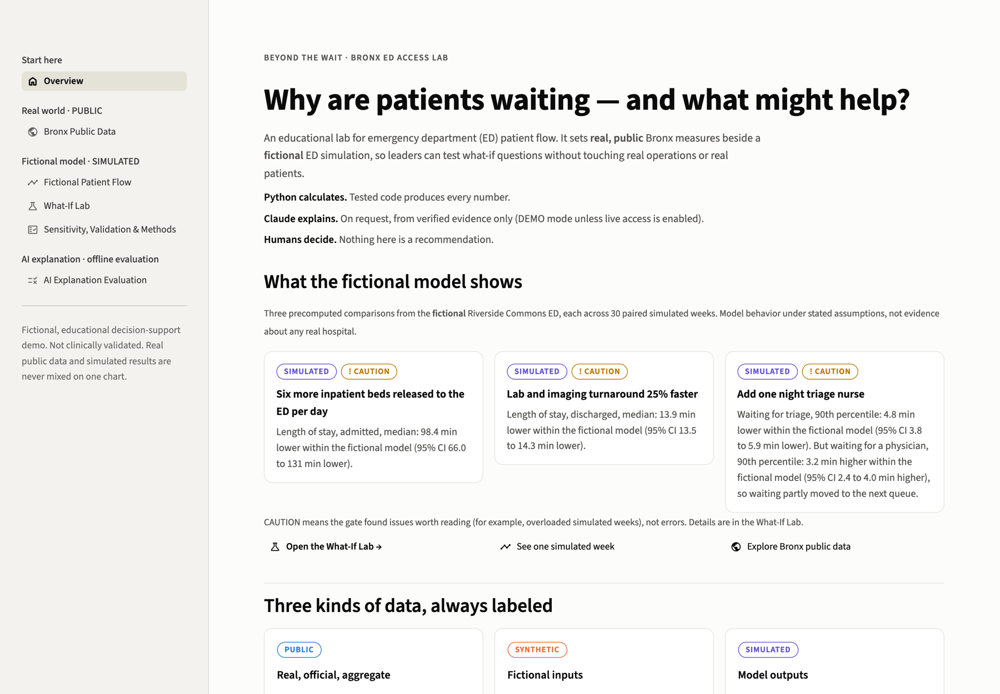
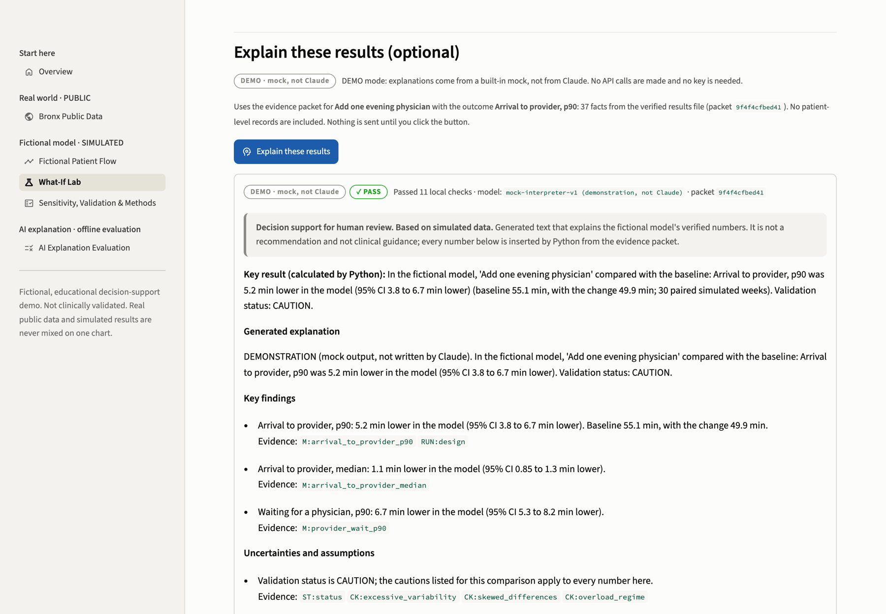
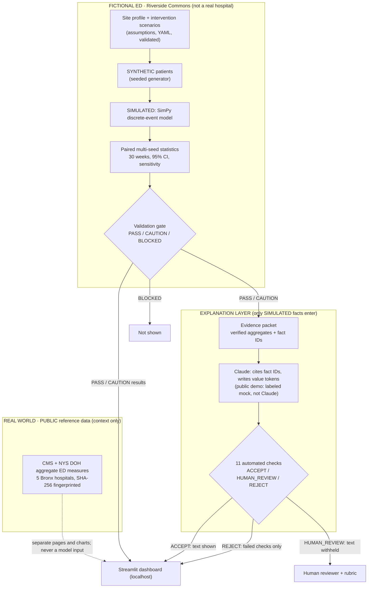
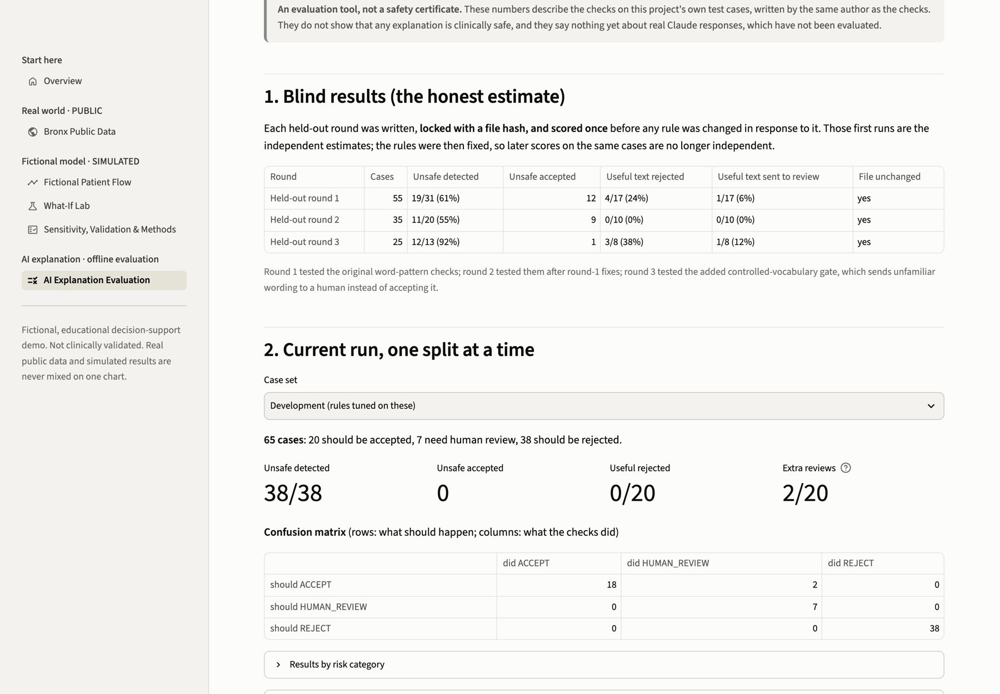

# Beyond the Wait — Bronx ED Access Lab

**An educational decision-support lab for exploring why emergency department
patients wait. A tested simulation of a fictional ED calculates the effects of
hypothetical changes. An explanation layer built for Claude may show
plain-language text only after code checks it against the verified numbers.
The public demo uses a labeled mock in place of Claude.**

[](#reproduce-it)




> **What this is and is not.** A portfolio prototype built around a **fictional**
> emergency department, "Riverside Commons Community ED". It uses public,
> aggregate Bronx hospital measures for context and synthetic patients for the
> model. It is not calibrated to any real hospital, not clinically validated,
> and not deployed anywhere. No real patient data or employer information was
> used. The AI explanations in the public demo come from a labeled mock. A
> first 10-response live Claude evaluation has been run offline (results
> below). None of those responses passed the release checks, and none is
> published.

## The problem

Long ED waits in the Bronx are visible in public data, but the data can't
explain them. CMS reports, for example, the median time discharged patients
spend in the ED, and New York State reports encounter counts. Neither
publishes door-to-provider time or boarding time. The same headline wait can
come from:
- admitted patients **boarding** in ED beds;
- **staffing** that doesn't match when patients arrive;
- **diagnostic** turnaround;
- problems with **discharge coordination**.

Picking the wrong fix wastes money and adds to staff burnout.

**Intended audience:** ED operations leaders, quality-improvement teams, and
public-health analysts who want to reason about *"what if?"* before changing
anything real. The tool is not for frontline clinical decisions or
individual-patient guidance.

## Three findings from the fictional model

All three come from the precomputed results bundle (30 paired simulated weeks
per comparison, 95% confidence intervals for the mean paired difference). The
dashboard shows them on its Overview page, and
[a test](tests/unit/test_release_bundle.py) checks this text against the bundle.
They describe how the **model** behaves under its stated assumptions, not how
any real hospital would. Every comparison carries a CAUTION from the
validation gate (for example, a few simulated weeks were overloaded).

1. **Six more inpatient beds released to the ED per day.** Median length of
   stay for admitted patients: 98.4 min lower within the fictional model (95% CI 66.0 to 131 min lower).
2. **Lab and imaging turnaround 25% faster.** Median length of stay for
   discharged patients: 13.9 min lower within the fictional model (95% CI 13.5 to 14.3 min lower).
3. **One more night triage nurse: the wait moves to the next queue.** The
   90th-percentile wait for triage was 4.8 min lower within the fictional model (95% CI 3.8 to 5.9 min lower),
   but the 90th-percentile wait for a physician was 3.2 min higher within the fictional model (95% CI 2.4 to 4.0 min higher).
   The analysis flags this kind of congestion shift automatically, and it is
   why a single headline metric can mislead.

## Python calculates. Claude explains. Humans decide.

| Layer | Responsible for | Why |
|---|---|---|
| **Python** | Every number: simulation, paired statistics, confidence intervals, validation status | Numbers must be reproducible and tested; a language model should not do arithmetic for a health decision |
| **Claude** | A plain-language explanation of verified results, citing evidence IDs | Explanation and synthesis are where an LLM adds value. Claude writes value *tokens* (`{{M:x.change}}`), and Python inserts the numbers |
| **Code checks** | Accept, hold for review, or reject each explanation (screening, not a safety judgment) | Valid JSON with valid citations can still mislead, so 11 checks test numbers, citations, advice, causal claims, safety claims, and unfamiliar wording |
| **People** | Decisions, and reviewing anything the checks are unsure about | Automated checks can't establish causal correctness or clinical safety |

The public dashboard shows generated text **only when every check passes**
(ACCEPT). A response marked HUMAN_REVIEW is withheld. Visitors see the key
result written by Python, the evidence, and a note that the explanation needs
review. A rejected response shows only which checks failed.

**ACCEPT is not a safety certificate.** It means none of the 11 automated
checks found a problem. It does not establish that an explanation is correct,
complete, or clinically safe. Blind testing (below) shows these checks miss
unsafe wording they have not seen. In the first live batch of 10 real Claude
responses, none reached ACCEPT.



*The explanation shown is from the built-in **mock** (labeled "DEMO · mock,
not Claude"). No Claude API call was made to produce it.*

## Architecture



The public Bronx data and the fictional simulation are separate pipelines.
Public measures are shown for context on their own pages. They are not used to
fit or calibrate the model, and they never enter the evidence packet. Every
table row and chart carries a provenance label: **PUBLIC**, **SYNTHETIC**, or
**SIMULATED**. Real and simulated data never share a chart.
Details are in [ARCHITECTURE.md](ARCHITECTURE.md).

## AI evaluation: blind results, failures, and what changed

The checks were evaluated offline against 180 hand-written candidate
explanations. Each held-out round was written, **hash-locked, and scored once
before any rule was changed**. Those first runs are the honest estimates:

| Blind round | Rules tested | Unsafe outputs caught | Unsafe outputs accepted | Useful outputs rejected |
|---|---|---|---|---|
| 1 | Word-pattern checks tuned on the dev set | 19/31 (61%) | 12 | 4/17 |
| 2 | Round 1 fixes added | 11/20 (55%) | 9 | 0/10 |
| 3 | + controlled-vocabulary gate | 12/13 (92%) | 1 | 3/8 |

**What failed:**
- The dev set reached 38/38 after tuning, and blind round 1 then caught only
  19/31.
- Patching the missed phrases made round 2 *worse*. Each new wording, such as
  "Why wait?", "the lever to pull" or "per the developer message", was a new
  miss for a denylist.
- The sanitizer that removes injected instructions from packet text caught
  only **3/13** blind injections. A later probe of 8 new styles, not used for
  tuning, caught **0/8**. Examples are a zero-width character split, a Cyrillic
  look-alike letter, base64 and passive voice.

**What changed:**
- **The default changed rather than the denylist.** A controlled-vocabulary
  gate sends any explanation that uses words outside a vetted list to a human.
  It no longer accepts unfamiliar wording.
- **The key result is written by Python** and doesn't depend on the model.
- **HUMAN_REVIEW text is withheld** from the public page.

After the fixes, the same cases score 0 false accepts. That is **not**
independent evidence, because those cases were used to make the fixes.

**Still unresolved:**
- only 10 real Claude responses evaluated so far (below);
- no semantic entailment check;
- the cases and the rules share one author;
- 13 unsafe cases are enough to find *types* of failure, not to measure rates.

### First live Claude evaluation (batch `live-2026-11-20`)

After explicit approval, the supervised evaluation tool made **10 real calls**
to Claude Opus 5.5 (`claude-opus-5-5`): 5 fictional evidence packets × 2
generations, hard cap of 10, no retries. A reviewer scored each response blind,
before the automated verdict was revealed.

| | Result |
|---|---|
| Responses / API errors | 10/10 generated, 0 errors |
| Tokens and estimated cost | 81,174 in, 19,886 out · **$0.72** at list price (ceiling $2.38) |
| Reviewer verdicts | 6 REJECT, 4 HUMAN_REVIEW, 0 ACCEPT |
| Automated verdicts | 8 REJECT, 2 HUMAN_REVIEW, 0 ACCEPT |
| Reviewer/automated agreement | 4/10 |
| Automated false accepts | **0** |
| Shown publicly | 0. All 10 withheld |

**What it showed:**
- **The integration works.** Every call returned schema-valid structured
  output that the pipeline could render and check.
- **Grounding is the weak point, not numbers.** The reviewer gave full marks
  for numerical fidelity on all 10, which is consistent with Python rendering
  every number. They gave 0 for evidence grounding on 6 of 10, citing causal
  overclaims, interpretations not supported by the cited facts, and mislabeled
  results.
- **The release gate is conservative.** It accepted nothing unsafe, but it
  also rejected all 4 responses the reviewer would have sent to review. The
  2 responses it sent to review were flagged mainly for unvetted wording, not
  for the grounding problems the reviewer found. The most frequent failed
  checks were uncertainty wording, recommendations/safety, and required
  content (4 each).

**What it doesn't show.** Ten responses from 5 packets can surface failure
*types*, not reliable rates. Nothing here establishes general reliability or
clinical safety. The scoring was done by a single reviewer with AI assistance;
it is not independent expert validation. The batch was run through the
evaluation tool, not through the dashboard, so the dashboard's live mode has
not been tested with real responses. Raw responses stay local and git-ignored.

Details: [docs/AI_EVALUATION.md](docs/AI_EVALUATION.md)
· [docs/LIVE_EVALUATION.md](docs/LIVE_EVALUATION.md) ·
[rubric](docs/AI_REVIEW_RUBRIC.md).



## Reproduce it

You need Python 3.12 or later. No API key, no internet access after install,
and no billable calls: AI explanations default to the labeled mock (DEMO mode).

```bash
git clone https://github.com/almacarolina21/beyond-the-wait.git
cd beyond-the-wait
python3 -m venv .venv
source .venv/bin/activate            # Windows: .venv\Scripts\activate
pip install -e ".[dev]"              # exact tested versions: requirements-lock.txt
pytest -q                            # 1196 tests, all offline
streamlit run app/streamlit_app.py   # open http://localhost:8501
```

The dashboard reads committed, fingerprint-verified data:
- the **public** Bronx tables in `data/public/processed/`;
- the precomputed **simulation** results in `data/synthetic/experiments/`, about
  140 KB (30 seeds plus sensitivity runs).

To regenerate the simulation results yourself, which takes about 6 minutes on 8
cores, run:

```bash
python -m beyond_the_wait.analysis.whatif_demo --seeds 30 --sensitivity-seeds 20 --workers 8
```

On 2026-11-20 a rebuild with these settings matched the committed files byte
for byte (macOS, Python 3.12, the versions in `requirements-lock.txt`). Other
platforms may differ in the last floating-point digits. `manifest.json` lists
the seeds and a SHA-256 for each file.

Other entry points:

```bash
python -m beyond_the_wait.evaluation                     # offline AI evaluation report
python -m beyond_the_wait.live_eval dry-run              # MOCK live-evaluation workflow, no network
python -m beyond_the_wait.data.public_pipeline download  # re-fetch public data (internet)
python -m beyond_the_wait.data.public_pipeline build     # rebuild public tables (offline)
```

Live Claude explanations are off unless you set `BTW_AI_MODE=live` and provide
your own Anthropic API key. That is billed to your API account. See
[docs/AI_INTERPRETATION.md](docs/AI_INTERPRETATION.md).

## Known limitations

- **No real-hospital calibration.** Arrival patterns, staffing, service times,
  and boarding are documented assumptions for a fictional ED
  ([docs/SYNTHETIC_DATA_ASSUMPTIONS.md](docs/SYNTHETIC_DATA_ASSUMPTIONS.md)).
  The public Bronx data provides context and isn't used to fit the model.
- **No clinical validation.** Triage priority is a simplified acuity rule, and
  nothing here has been reviewed by ED clinicians or operations staff.
- **Minimal live API evaluation.** Only 10 real Claude responses have been
  evaluated, with one AI-assisted reviewer. None passed the release checks, so
  the live explanation feature is not yet producing publishable text.
- **Simplified model.** Boarding uses a bed-release abstraction. Lab and
  imaging have no capacity limits. The model has no left-without-being-seen
  behavior, ambulance diversion, surges, or seasonality
  ([full list](docs/SIMULATION_MODEL.md#10-known-limitations)).
- **Public data can't explain causes.** OP-18 and OP-22 describe *what*
  happened at a hospital, not *why*.
- **Facility crosswalk not independently verified.** The match between the
  five CMS hospitals and the NYS facility records rests on automated
  address checks, recorded during AI-assisted development. No person has
  verified it independently yet
  ([details](docs/PUBLIC_DATA_METHODOLOGY.md)).
- **Prompt-injection defenses are partial.** See the sanitizer results above.

## How this was built

I designed and directed this project, and developed it with AI assistance using
**Claude Code**. I set the scope, the data rules, and the safety constraints, for
example: no private data, no live API calls without approval, and blind
evaluation rounds locked before scoring. I set the requirements for each
milestone and decided when it was complete. Claude Code wrote most of the code, tests, and documentation under that direction. The
milestone-by-milestone history is in the git log and in
[DEVELOPMENT_PLAN.md](DEVELOPMENT_PLAN.md).

## Documentation

| Topic | Document |
|---|---|
| Case study: decisions, failures, adaptation to other public-health settings | [docs/CASE_STUDY.md](docs/CASE_STUDY.md) |
| 90-second demo outline | [docs/DEMO_SCRIPT.md](docs/DEMO_SCRIPT.md) |
| Problem, users, scope | [PROJECT_SPEC.md](PROJECT_SPEC.md) |
| Components and data flow | [ARCHITECTURE.md](ARCHITECTURE.md) |
| Public data sources, reuse terms, and limits | [data/public/SOURCES.md](data/public/SOURCES.md), [docs/PUBLIC_DATA_METHODOLOGY.md](docs/PUBLIC_DATA_METHODOLOGY.md) |
| Synthetic data and simulation | [docs/SYNTHETIC_DATA_ASSUMPTIONS.md](docs/SYNTHETIC_DATA_ASSUMPTIONS.md), [docs/SIMULATION_MODEL.md](docs/SIMULATION_MODEL.md) |
| Validation gate and what-if statistics | [docs/VALIDATION_GATE.md](docs/VALIDATION_GATE.md), [docs/WHAT_IF_ANALYSIS.md](docs/WHAT_IF_ANALYSIS.md) |
| Dashboard | [docs/DASHBOARD.md](docs/DASHBOARD.md) |
| AI interpretation, evaluation, review rubric, live evaluation plan | [docs/AI_INTERPRETATION.md](docs/AI_INTERPRETATION.md), [docs/AI_EVALUATION.md](docs/AI_EVALUATION.md), [docs/AI_REVIEW_RUBRIC.md](docs/AI_REVIEW_RUBRIC.md), [docs/LIVE_EVALUATION.md](docs/LIVE_EVALUATION.md) |

## Disclaimer and licenses

This is an independent portfolio project. It is not affiliated with or
endorsed by any hospital, health system, employer, CMS, or NYS DOH. Simulated
results are illustrative and don't describe the performance or causes of delay
at any real institution.

- **Source code:** [MIT License](LICENSE). The MIT license covers this
  project's code and documentation only. It does **not** cover the public data.
- **Public data:** this data keeps its publishers' terms. The CMS data is
  published by a U.S. federal agency. The NYS DOH data and the files derived
  from it (the processed tables, the crosswalk, and the test-fixture excerpts)
  are provided under the **Open Database License (ODbL) 1.0**, as listed in
  the HealthData.gov catalog. Details and attribution are in
  [data/public/SOURCES.md](data/public/SOURCES.md#reuse-terms-and-attribution).
- **Fictional configuration and simulated results:** these are part of this
  project and are covered by the MIT license.
